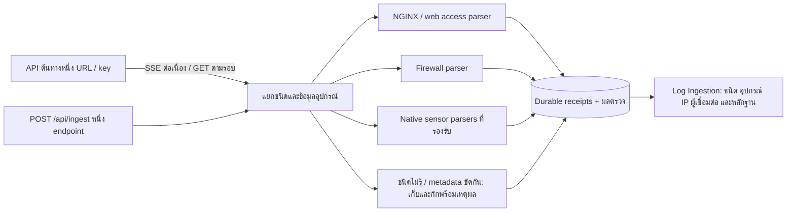

> **บันทึกย้อนหลัง:** อาจอ้างไฟล์/คำสั่งที่นำออกแล้ว ขั้นตอนติดตั้งปัจจุบันอยู่ใน [DEPLOY](../../DEPLOY.md) และ [README](../../README.md)

# Log API จุดเดียว — 14 ตุลาคม 2026

**รุ่นล่าสุดรองรับ SSE ต่อเนื่องแล้ว** ผล diagnostic จริงยืนยัน `/v1/stream` เป็น text/event-stream ไม่ใช่ snapshot ดูการเปลี่ยนโค้ด วิธี deploy และข้อจำกัดการ replay ใน [SSE_API_REVIEW.md](SSE_API_REVIEW.md) ข้อความเรื่องยังไม่รองรับ SSE ด้านล่างเป็นผลตรวจรุ่นก่อนการแก้ครั้งนี้

แก้กรณีต้นทางคืนหน้าเว็บ HTML แทน log: ตรวจ Content-Type/HTML signature ก่อนแยกบรรทัด และไม่เก็บหน้าเว็บเป็น generic receipts อีก กรณี ERR_BAD_RESPONSE แยกข้อความขนาด response เกิน limit, stream ขาดกลางทาง และ timeout โดยไม่เผย URL/key จาก exception เพิ่ม `check-log-api.ps1` สำหรับอ่าน status, content type, content length, SSE flag และสถิติ response ด้วย key ที่บันทึกใน backend โดยไม่แสดงเนื้อหา log/key และไม่เขียน DB ตัวตรวจเก็บ sample สูงสุด 64 KiB/10 วินาที พร้อมขอ Accept-Encoding: identity เพื่อดูขนาดข้อมูลที่ไม่บีบอัด

การดึงปัจจุบันรองรับ response ที่จบในแต่ละรอบ (JSON/NDJSON/raw text) ยังไม่ใช่ consumer สำหรับ SSE ที่เปิดค้างตลอด `/v1/stream` เพียงชื่อ path ยังไม่ยืนยันสัญญาของ API ต้องดูผลตรวจจริงหลัง authenticate ก่อนปรับรูปแบบรับ stream และ checkpoint ไม่เพิ่ม limit หรือปิด TLS เพื่อเดาสาเหตุ รายการ HTML เดิมไม่ลบและไม่สร้าง alert เทียม

รันจาก primary project: `.\ecs-release\check-log-api.ps1` โดยกรอกรหัส SSH/sudo ใน terminal ส่งเฉพาะบรรทัด `api_response_diagnostic` กลับมา ตัวตรวจใช้กับ backend ที่มี single API modules อยู่แล้วโดยไม่ต้อง deploy ก่อน ส่วนการแก้ข้อความ error/HTML guard ต้อง deploy release ใหม่

ผ่านการทดสอบล่าสุด: backend build, 30 HTML/error/real HTTP response checks (รวมกรณี 2 MB limit และ body ขาดกลางทาง), 36 classifier/migration regression checks, 5 authenticated bounded HTTP diagnostic scenarios (JSON/HTML/401/oversize/SSE และยืนยันไม่พิมพ์ credential/body), PowerShell parser check ยังไม่ได้ตรวจ response หลัง authenticate ของ API จริง และยังไม่ได้ deploy server

เพิ่มการรองรับ outbound HTTPS CA ใน release ล่าสุด: backend mount โฟลเดอร์ CA แบบ read-only และใช้ NODE_EXTRA_CA_CERTS โดยไม่ปิดตรวจ TLS ค่าเริ่มต้นยังไม่เปิด CA เพิ่มเติม ดูขั้นตอนและตำแหน่งไฟล์ใน [HTTPS_CA_SETUP.md](HTTPS_CA_SETUP.md) ทดสอบ CA/TLS 14 checks, Compose ค่าเริ่มต้น/กำหนดเอง, และ installer preservation 6 tests ผ่าน ยังไม่ได้ติดตั้ง CA หรือ deploy บน server จริง

ปรับชุด production ให้มีการตั้งค่า URL/key หนึ่ง connection และใช้ classifier ร่วมกันสำหรับ GET/POST รุ่นก่อนยังมีสามฟอร์มและ fallback polling แบบแยก NGINX/Firewall รุ่นนี้เหลือหนึ่งฟอร์มและดึงเฉพาะ connection `combined`



## แยกอะไรและมาจากไหน

| ข้อมูล | วิธีใช้ |
|---|---|
| event.module / event.dataset / source ที่เป็นชื่อชนิด | เลือก parser จากข้อมูลที่ต้นทางระบุ เช่น nginx, fortinet |
| observer.product / vendor | ใช้ประกอบการแยกและเก็บผลิตภัณฑ์/ผู้ผลิต |
| HTTP fields หรือ access text; Firewall key-value fields | ใช้ตรวจรูปแบบเมื่อไม่มี metadata ที่ระบุชนิด |
| observer.name / hostname / ip | ชื่อ/IP อุปกรณ์ที่บันทึก เช่น rev-proxy-c, KKU_FG3K4E |
| host.name / agent.name | ข้อมูล host/agent ที่ต้นทางให้มา |
| source.ip / remote_addr / srcip | IP ผู้เชื่อมต่อหรือผู้โจมตี แยกจาก IP อุปกรณ์ที่บันทึก |
| feedHost / transport | host ของ API ที่ SIEM เรียก และการรับผ่าน api_get/api_post ซึ่งระบบเติมเอง |
| basis | field/รูปแบบที่ใช้แยก หรือ conflicting_metadata/unrecognized_format |

ชื่อ `nginx` ในคอลัมน์ **ชนิด / parser** คือ adapter ที่ใช้ประมวลผล web access รูปแบบที่เข้ากันได้ ไม่ใช่หลักฐานยืนยันผลิตภัณฑ์ ถ้า raw text ไม่มีชื่ออุปกรณ์/metadata จะระบุ **ไม่ระบุ** ไม่สร้าง hostname/IP ขึ้นเอง ข้อมูลอุปกรณ์เป็นข้อมูลที่ producer ระบุ ไม่ใช่การยืนยันตัวตนอุปกรณ์ด้วย signature

รองรับ ECS NGINX/Firewall ตามตัวอย่างของคุณ, native Wazuh/Cowrie/Suricata/Webtrap ที่ parser เดิมรองรับ และ SSH failure syslog ที่ระบุรูปแบบได้ ECS ของ sensor ชนิดอื่นที่ยังไม่มี field mapping ที่รองรับจะถูกกัก ไม่ตีความเป็น benign โดยไม่มีหลักฐาน

## ค่าเดิมและ key

- มี combined เดิม: ใช้ต่อและปิด flags ของ connection แยก
- มี legacy ที่เลือกได้ชัดเจนหนึ่งชุด: ย้ายโดย transaction รักษา encrypted key และ setting อื่น
- มี legacy ต่าง URL/key/รูปแบบหลายชุดที่ยังเลือกไม่ได้: ไม่เริ่มดึงหลาย API หน้าเว็บให้เลือกหนึ่งชุดหรือกรอกใหม่ Test GET ใช้ key เก่าที่เลือกได้โดยไม่เปิดเผย key
- เก็บ legacy URL/key ไว้ใน DB แบบปิดใช้งาน ไม่ลบ key เดิม
- backend ไม่รับการตั้งค่ารายชนิด `/api/log-sources/nginx` หรือ `/firewall` แล้ว ใช้ POST `/api/log-sources`, `/test`, `/pull`; alias combined รุ่นก่อนใช้ connection เดียวกัน
- POST ส่ง log หลายชนิดใน array เข้า `/api/ingest` ได้ โดยใช้ INGEST_API_KEY ของ SIEM ส่วน GET ใช้ key ของ API ต้นทางตามฟอร์ม
- ไม่เปลี่ยน .env, TLS, TOTP encryption key หรือ database volumes จากการจัดแพ็กเกจนี้

ก่อนเปิดดึง ให้ดู preview ว่า sourceCounts มีชนิดที่คาดหวัง ถ้า URL เดิมมี query จำกัดเฉพาะ nginx หรือ array path ชี้เฉพาะ Firewall ต้องเปลี่ยนเป็น URL/path ของ feed รวมตาม API ต้นทาง โค้ดไม่สามารถสร้าง log ของชนิดที่ API ไม่ได้ส่งกลับมาได้

## ตรวจพบและแก้เพิ่ม

- GET/POST ใช้ classifier เดียวกันและเก็บ origin กับหลักฐานการแยกไว้ใน receipt
- metadata ของ ingestion ไม่ถูกส่งเป็นเนื้อหา raw ให้ detection จึงรักษา event identity/detector cache เดิม
- raw digest ไม่เปลี่ยนจากการเติม origin; producer ส่ง ingest_origin ปลอมมาเองจะไม่ใช้เป็นที่มาที่ระบบรับรอง
- กรณี wrapper/group ระบุ Firewall แต่เนื้อหาเป็น NGINX หรือ metadata ระบุชนิดขัดกัน ให้เก็บและกักพร้อมเหตุผล
- POST ที่ไม่มีชนิดที่รู้จักจะถูกกักเช่นเดียวกับ GET ไม่ใช้ fallback ที่เดา Wazuh จาก rule.id อย่างเดียว หรือ Webtrap จาก type ที่กำกวม
- หน้าเว็บห้ามกด Pull ด้วยค่าที่เพิ่งแก้แต่ยังไม่บันทึก ป้องกันเข้าใจว่าดึง URL ใหม่ทั้งที่ใช้ค่าที่บันทึกเก่า
- เมื่อบันทึก config ล้างสถานะ GET เก่า เพื่อไม่ให้ผลสำเร็จของ URL/key ก่อนหน้าปะปน
- diagnostic helper ใช้ single connection และแสดง origin โดยไม่พิมพ์ keys/raw response

ผลการโจมตียังคงใช้ alert policy/network scope เดิม การแยกชนิดสำเร็จไม่ได้แปลว่าเป็นการโจมตี รายการที่ไม่ได้สร้าง alert ยังดูเหตุผลได้ใน Log Ingestion ส่วน origin ของรายการเก่าที่ไม่มี field ใหม่ดูได้ผ่านปุ่มต้นฉบับ/หลักฐาน ต้นฉบับที่หมดอายุตาม retention จะกู้ที่มาที่ยังไม่ได้เก็บไว้ไม่ได้

## ผลตรวจ

- Build backend/frontend ผ่าน เปิดครบหกบริการ healthy ใน stack แยก
- ผ่าน 36 classifier/provenance/conflict/migration checks
- HTTP/DB integration ผ่าน: connection เดียว, legacy endpoints ถูกปิด, GET mixed ECS, ใหม่/ซ้ำ, 2 benign + 2 alerts + 1 unknown quarantined
- Migration ผ่าน transaction/idempotence/key preservation/setting preservation/เลือก key เดิมก่อน Test GET และ polling จุดเดียว
- POST raw/ECS regression และ retry dedupe ผ่าน
- Raw identity และการปฏิเสธ ingest_origin ที่ producer ปลอม ผ่าน
- Chromium ยืนยันหนึ่งฟอร์มจริง และแสดงอุปกรณ์ผู้บันทึกแยกจาก IP ผู้เชื่อมต่อ
- Server helper ผ่านกับ stack จำลอง: รับจาก connection เดียว พร้อม origins; synthetic detection cases 32/32 ผ่าน

ผลเหล่านี้เป็นชุดทดสอบจำลอง ไม่ใช่เปอร์เซ็นต์ความแม่นยำของทุก log จริง และยังไม่ได้ deploy ไป server โดย agent

## นำไปใช้งาน

แพ็กเกจที่ตรวจแล้วอยู่ใน `ecs-release` (source ในโฟลเดอร์หลักยังต่างรุ่น) มีตัวเรียกจากโฟลเดอร์หลักชื่อ `deploy-single-api.ps1` เพื่อให้ไม่เลือก deploy script ผิดรุ่น:

```powershell
cd C:\Users\InternCY\Documents\GitHub\Demo_Honeypot
.\deploy-single-api.ps1 -ServerIP 10.101.104.234 -Username napat -RemoteDir '~/siem_v2'
.\ecs-release\sync-config.ps1 -AfterDeploy
```

เปิด Settings → Log API จะเห็น **หนึ่งฟอร์ม** ถ้าค่าเดิมมีหลายชุด ให้เลือกชุดเดียว จากนั้น Test GET → บันทึก → ดึง log ตอนนี้ ข้อมูลจริงตรวจใน Log Ingestion และกดดูต้นฉบับ/ที่มา/คะแนน

```powershell
.\test-log-pipeline.ps1
```

รายงานอยู่ที่ `ecs-release\log-pipeline-report.jsonl` ส่วน `live_api.origins` เป็นข้อมูลอุปกรณ์/หลักฐานการแยก ส่วน `live_api.decisions` แสดงเหตุผลของการตรวจใน engine ชั่วคราว ไม่เพิ่ม alert ทดสอบลงฐานจริง

ยังต้องใช้ URL/response wrapper ของ API จริงให้ตรง และต้องดู pagination/cursor/ช่วงเวลาของต้นทางเพื่อยืนยันว่าดึงครบ การเรียก HTTP 200 แต่คืน snapshot เดิมจะนับซ้ำและไม่สร้างรายการใหม่

ดู diff ได้ที่ `single-api-fix.patch` ไม่มี .env/TLS หรือ key จริงรวมในแพ็กเกจ
